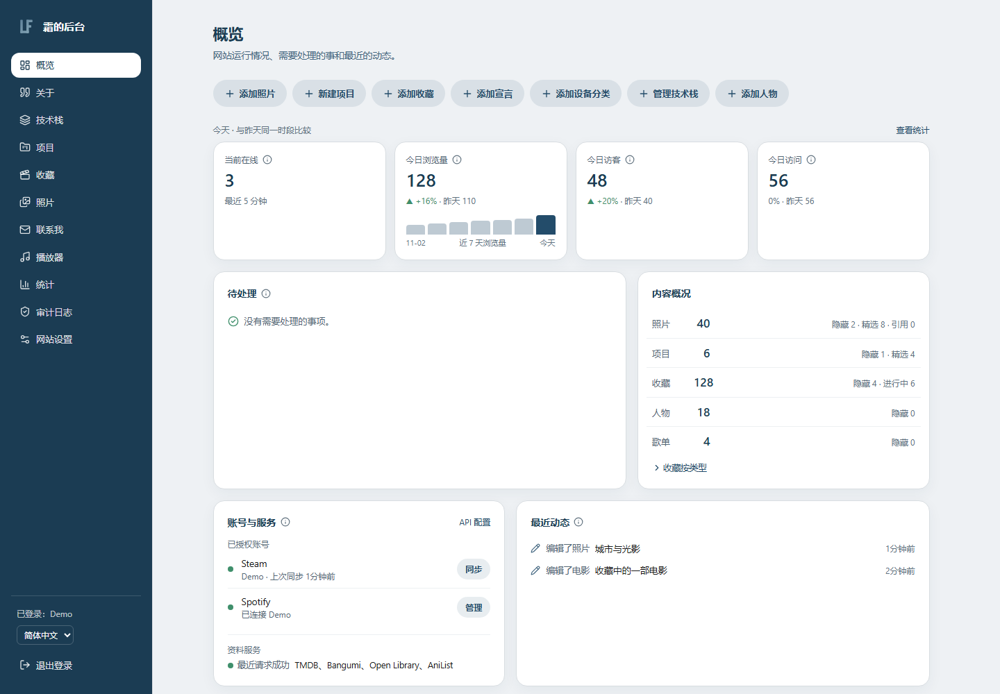

# Liam Frost · 个人网站

[English](README.md) · 简体中文

用于展示摄影、软件项目，以及影视、书籍、游戏和音乐收藏的个人网站。采用 TypeScript monorepo，包含独立的前台、管理后台和 Fastify API。

**[访问网站](https://www.twilightfrosty.com)** · [项目文档](docs/README.md) · [反馈问题](https://github.com/Liam-Frost/Liam-Frost.github.io/issues) · [报告安全漏洞](SECURITY.md)

## 功能

- **摄影作品集**：响应式图库、全屏浏览、照片元数据和自适应图片质量。
- **项目展示**：技术筛选、多语言项目资料、Markdown 描述和项目图片。
- **媒体收藏**：电影、剧集、动画、书籍、漫画、游戏、音乐和人物与团体，支持评分、评论、进度、关联与年度回顾。
- **人物与团体**：TMDB 影视人物、MusicBrainz 音乐艺人搜索导入、手动资料、别名、多来源身份和独立成员关系；已确认艺人 ID 自动关联已有音乐，同名仅生成待确认建议。
- **音乐与游戏集成**：Spotify 账号导入、歌单管理、站内播放器、Spotify 播放器和 Steam 库同步。
- **独立管理后台**：管理内容、图片上传和批量操作；后台代码不进入前台 bundle。
- **多语言前台**：英文、简体中文、繁体中文、日文、法文，支持浅色与深色主题。后台目前主要使用中文。
- **可配置首页**：宣言及非固定模式的相对出现权重、器材、技术栈、联系方式、板块开关；空板块自动隐藏。
- **收藏管理**：按标题、日期、年份、评分排序，独立精选排序页，共享标签翻译和自定义标签回退。
- **统一网站设置**：前台资料与头像、版权、主题/语言初值、隐私说明、标签词典及首页开关；前后台独立 Logo、图库登录背景及全站图标。后台归并集成、统计与审计入口，账号和路径仍由运行配置管理。
- **统计与审计**：内容访问、站内点击播放和播放/载入分别统计；管理员登录等操作的只读审计记录。Spotify 内嵌播放器内部的真实收听行为无法直接观测。
- **性能与可访问性**：按维度调整动效、滤镜、图片和预取预算，扫光骨架屏、减少动态支持、按章节恢复刷新位置。
- **统一风格的错误页**：前台 404 提供返回首页和作品集入口，API 保留结构化错误。

## 界面预览

个人主页：


管理后台概览（演示数据）：



网站持续迭代中。[预发布站](https://preview.twilightfrosty.com)用于验证开发版本；本 README 描述当前源码，具体上线状态以发布记录为准。主机、基础设施配置、凭据、诊断及运维资料均在私有位置维护。

## 技术栈

| 部分     | 技术                                             |
| -------- | ------------------------------------------------ |
| 前台     | React、React Router、Vite、TypeScript            |
| 后台     | React、Tailwind CSS、TanStack Query              |
| API      | Fastify、Zod、Node.js                            |
| 数据     | PostgreSQL 16、Prisma                            |
| 图片     | sharp、EXIF 提取、本地上传存储                   |
| 运行环境 | Docker Compose、Caddy、统一应用镜像              |
| 质量保障 | Vitest、ESLint、Prettier、GitHub Actions、CodeQL |

完整运行环境使用同源访问：Caddy 转发给 Fastify，由 Fastify 提供前台、后台、API 和上传资源。开发时由两个 Vite 服务分别提供前后端页面并代理 API。

## 本地快速开始

需要 **Node.js 26.13+**、npm，以及完整功能所需的 PostgreSQL。容器运行和集成测试需 Docker Compose v2。

```sh
git clone https://github.com/Liam-Frost/Liam-Frost.github.io.git
cd Liam-Frost.github.io
npm ci
```

仅查看带内置照片内容的前台：

```sh
npm run dev:web
```

打开 <http://localhost:5173>。如需数据库内容和管理后台，继续以下步骤：

```sh
cp apps/api/.env.example apps/api/.env
docker compose up -d postgres
npm run auth:hash -- "replace-with-your-own-password"
node -e "console.log(require('crypto').randomBytes(32).toString('base64url'))"
```

在 `apps/api/.env` 配置 `DATABASE_URL`，并将后两个命令的输出分别写入 `ADMIN_PASSWORD_HASH` 和 `ADMIN_SESSION_SECRET`。可同时配置 `ADMIN_USERNAME` 与 `ADMIN_PATH`。提供方密钥为可选项；MusicBrainz 不需要 API 密钥。完整说明见[后台指南](docs/admin.md)和示例环境文件。

```sh
npm run db:deploy
npm run db:seed
npm run dev
```

`db:deploy` 应用已提交的迁移；`db:seed` 导入示例照片。复用此项目时请替换个人内容。

| 服务         | 默认本地地址                       |
| ------------ | ---------------------------------- |
| 前台         | <http://localhost:5173>            |
| 后台         | <http://localhost:5174/admin>      |
| API 健康检查 | <http://localhost:8787/api/health> |

后台地址跟随 `ADMIN_PATH`。开发服务读取 `apps/api/.env`，Docker Compose 读取根目录 `.env`。[本地开发说明](docs/local-development.md)涵盖代理、端口冲突与替代数据库配置。

## Docker 完整运行

```sh
cp .env.example .env
docker compose build
docker compose run --rm --no-deps --entrypoint node app apps/api/dist/hash-password.js "replace-with-your-own-password"
```

把输出散列写入根目录 `.env` 的 `ADMIN_PASSWORD_HASH`，并配置至少 32 字符的随机 `ADMIN_SESSION_SECRET`：

```sh
docker compose up -d --wait
docker compose exec app node apps/api/dist/seed.js
```

默认打开 <http://localhost:8080> 和 <http://localhost:8080/admin>。启动时自动应用待执行迁移，数据库与上传内容保存在 Docker 卷中。该配置用于本地验证；正式发布还需配置 HTTPS、备份、监控和经过测试的回滚流程。

## 开发命令

| 命令                                                        | 用途                                   |
| ----------------------------------------------------------- | -------------------------------------- |
| `npm run dev`                                               | 启动 API 与两个 Vite 服务              |
| `npm run dev:web` / `npm run dev:admin` / `npm run dev:api` | 单独启动服务                           |
| `npm run build`                                             | 构建前台、后台与 API                   |
| `npm run typecheck`                                         | TypeScript 类型检查                    |
| `npm test`                                                  | Vitest 测试                            |
| `npm run lint`                                              | 代码与 React Hooks 规则检查            |
| `npm run format:check` / `npm run format`                   | 检查 / 应用格式                        |
| `npm run db:migrate`                                        | 创建开发迁移                           |
| `npm run db:deploy`                                         | 应用已提交迁移                         |
| `npm run db:seed:collection`                                | 导入示例收藏、人物和歌单               |
| `npm run db:seed:analytics-demo`                            | 向名称含 demo 的数据库写入统计演示数据 |
| `npm run db:studio`                                         | 打开 Prisma Studio                     |
| `bash docker/smoke-test.sh`                                 | 使用临时数据验证完整容器环境           |

## 目录与质量要求

`apps/web` 为前台，`apps/admin` 为后台，`apps/api` 包含服务、数据库迁移和测试；`packages/shared` 提供共享类型，`packages/content` 提供照片种子内容；`docker`、`docs`、`scripts` 和 `.github` 分别存放容器配置、文档、维护脚本和 CI。

提交前运行 lint、format:check、typecheck、test 和 build。CI 检查格式、代码、类型、测试与构建；Docker 冒烟测试验证生产镜像、认证、上传、迁移和持久化。针对 main 的 PR 需要 Quality checks 与 smoke 通过。分支与维护规则见[仓库维护](docs/repository-maintenance.md)。

更多资料：[后台功能](docs/admin.md)、[数据库](docs/database.md)、[架构](docs/architecture.md)、[人物与收藏方案](docs/collection-admin-ux.md)、[认证保护与边界](docs/admin-security-review.md)、[性能系统](docs/performance.md)、[网站设置说明](docs/website-settings-ui.zh-CN.md)。

## 安全、许可与署名

安全问题请按 [SECURITY.md](SECURITY.md) 通过 [GitHub 私密漏洞报告](https://github.com/Liam-Frost/Liam-Frost.github.io/security/advisories/new) 提交，不要在公开 issue 或日志中放置凭据、会话 cookie 或个人数据。

原创软件源码和技术文档采用 **[MIT 许可证](LICENSE)**，复制或分发时保留版权与许可声明。页面可见署名非强制，欢迎链接回本仓库。

**照片、个人文字、肖像、品牌及第三方材料不属于软件许可范围。** 种子数据和引用链接的内容权利见 [CONTENT-LICENSE.md](CONTENT-LICENSE.md)。
