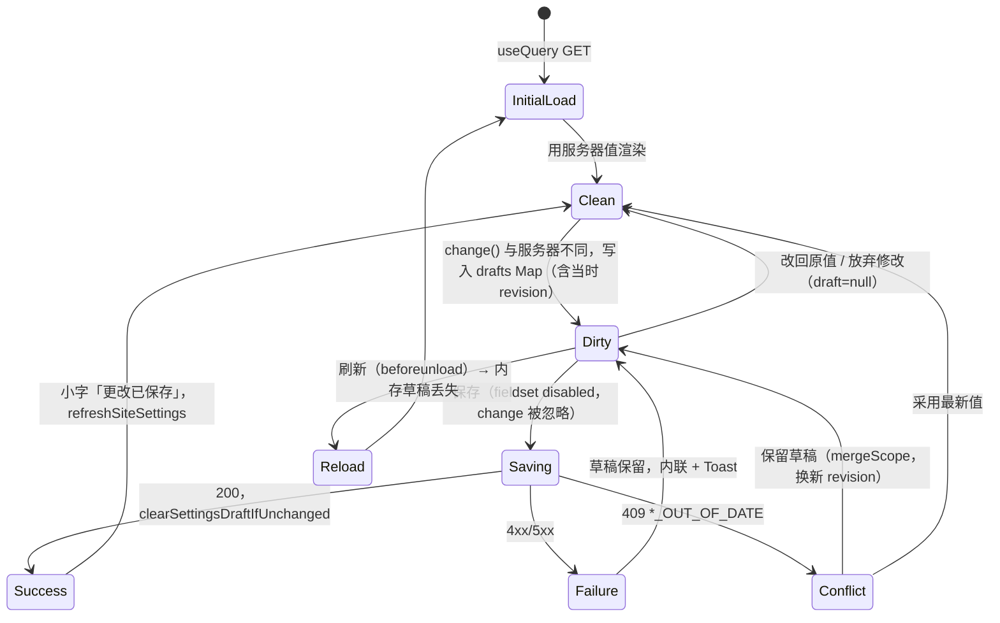
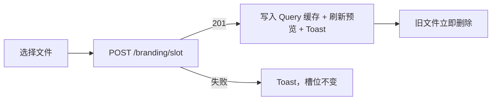
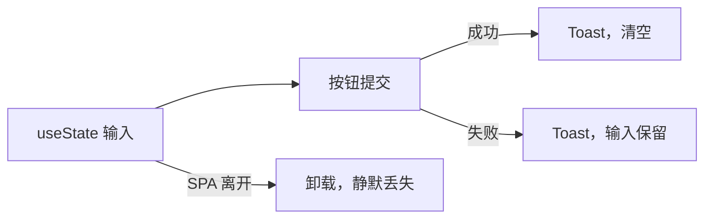

# 管理后台 UI/UX 全量架构审计

> 审计日期：2026-11-08。审计范围：`apps/admin`，重点是「网站设置」10 个子页、全局框架和技术栈页（作为基准）。
> 本次只做调查、测量和写报告，**没有修改任何业务代码、组件、样式、配置或依赖，也没有提交**。新增内容只有本文件和 `docs/archive/admin-settings-audit/audit-assets/`。

## 证据等级

| 标记       | 含义                                         |
| ---------- | -------------------------------------------- |
| 【代码】   | 已通过代码证实，给出文件和行号               |
| 【浏览器】 | 已通过浏览器复现，原始数据在 `audit-assets/` |
| 【设计】   | 设计判断，不是事实陈述                       |
| 【待验证】 | 现有证据不足，结论未定                       |
| Unknown    | 代码和历史里都没有依据，不做推断             |

## 基准与测量环境

- **代码基准**：本地分支 `feat/admin-i18n`（HEAD `4850c35`）。`git diff --stat HEAD origin/dev` 为空，文件树与 `origin/dev`（`d81188f`）一致。
- **运行方式**：把后台构建到临时目录，由真实 API 服务（`buildServer`，内存版 Settings 和账号仓库，一次性测试账号）提供。**没有连接生产或任何真实数据库，没有用真实凭据。**
- **浏览器**：Playwright Chromium，桌面模式（未开启 `isMobile`），`zh-CN`，浅色。
- **视口**：390×844、768×1024、1024×768、1280×800、1440×900、1920×1080。10 个设置页加技术栈页，共 66 组。
- **Mock 范围（只影响数据量，不影响布局代码）**：测试服务没有照片、技术栈、媒体仓库，因此 Playwright 拦截这些 GET 响应：`/api/admin/photos`（24 张）、`/stack`（3 分类 12 项）、`/media`（空）、`/presentation`（轮换 6 张）、`/site-settings/dictionary`（14 条）。其余接口走真实服务。页脚页的链接列表是空的，**该页高度偏小**。
- **滚动条**：`html { scrollbar-gutter: stable }` 让可用宽度比视口少 15px（768 → 753）。下文的宽度都是实际渲染值。

### 原始数据

| 路径                             | 内容                                                                                |
| -------------------------------- | ----------------------------------------------------------------------------------- |
| `audit-assets/measurements.json` | 66 组 DOM 数据：Bounding Rect、Computed Style、卡片、控件、Grid、overflow、祖先链   |
| `audit-assets/interactions.json` | 交互实测结果                                                                        |
| `audit-assets/screens/`          | 66 张整页截图（`页面-宽x高.jpg`）                                                   |
| `audit-assets/annotated/`        | 390 和 1440 视口的标注截图（紫 = main，粉 = content，蓝 = 卡片，绿 = 控件，带尺寸） |
| `audit-assets/interactions/`     | 脏状态、冲突、弹出层、侧栏、英文界面截图                                            |

---

## 1. Executive Summary

**总体判断**：后台不是「没有架构」，而是「架构只覆盖到内容区宽度」。`SettingsLayout → SettingsPage → SettingsSection` 这条骨架是真实存在并被遵守的，颜色 Token 的使用也很干净（1118 处颜色类，只有 2 处裸 `rgba`）。问题集中在骨架以下：内容区内部没有布局约定，卡片有 4 套实现，保存和离开保护有 6 种模型且互相矛盾。

最重要的发现：

1. **宽度由三层独立来源决定，第三层没有约定。** main（1440/1080）、路由映射的变体（640/880/1100）是系统化的；卡片内的列数和字段宽度由每页手写。同一视口下「基本资料」是 2×430 卡片，「默认显示与语言」是 1×640 叠放，后者第二张卡的控件只占内容宽度的 13.8%。【浏览器】
2. **列数断点看视口，不看内容宽度。** 768 视口下内容只有 485px，`sm:grid-cols-2` 依然生效，基本资料被挤成两张 233px 的卡。【浏览器】
3. **离开保护自相矛盾。** 设置页的草稿其实能保留，但点链接仍弹「确定离开吗」；同一草稿经页面选择器或后退离开却不弹；而「页面标题」「账号安全」「关于」的内容真的会丢，却完全不提示。【浏览器】
4. **「Logo、图标与标题」一页混合三种保存模型**：立即上传、中部的内联「保存 Logo」、独立的「保存页面标题」。放弃修改不会撤销已上传的图片。【浏览器】
5. **按文档存 revision，按页面分草稿，造成跨页冲突。** 基本资料有草稿时，到另一页保存页面标题，回来保存就 409，并向用户展示原始 JSON。【浏览器】
6. **切换语言时取消离开，状态会分裂。** localStorage 已是 `en`，页面仍是中文，下一次刷新静默变英文。【浏览器】
7. **后台语言入口的问题在归属，不在状态。** 三个挂载点是同一组件、同一存储，不可能不一致；但其中一个放在标题为「决定访客首次访问时的显示偏好」的页面里，且不走该页的保存模型。【代码】【浏览器】
8. **不存在自定义单选 Select。** 30 处 `<select>` 中 29 处走 `.field`，这是有记录的决策（`docs/decisions.md`，2026-11-02），不是遗漏。唯一的分叉是 `LanguageSwitch`：高 28px、原生 appearance、圆角 6px。【代码】【浏览器】
9. **手机上全局导航基本不可用。** 390 视口下导航只有 91px 宽（内容 945px），只露出「概览」，当前页入口在可视区之外且不会自动滚入。【浏览器】
10. **潜在隐患：登录背景里的照片被隐藏后，按代码推断 Logo、首页模块页也无法保存**，因为三页共用一个文档，服务端校验整份 `photoIds`。【代码】（未在浏览器复现，见第 12 节）

**没有发现的问题**（同样重要）：66 组测量中页面级水平溢出为 0；英文界面 22 组无溢出、无按钮折行；`.field` 高度全部 38px；页面标题 y=32、字号 22px 全站一致；吸底保存条在测试场景下未遮挡聚焦控件。

---

## 2. Architecture Map

### 2.1 技术栈

| 项           | 实际情况                                                                                                                              | 证据                        |
| ------------ | ------------------------------------------------------------------------------------------------------------------------------------- | --------------------------- |
| React        | ^19.3.1                                                                                                                               | `apps/admin/package.json`   |
| 路由         | react-router ^8.5.1，`BrowserRouter basename={ADMIN_BASE}`，ADMIN_BASE 来自服务端注入的 meta                                          | `apps/admin/src/App.tsx`    |
| 数据         | @tanstack/react-query ^5.105                                                                                                          | `package.json`              |
| 样式         | Tailwind ^4.3.3（`@tailwindcss/vite`），CSS-first `@theme`，**无 tailwind.config**                                                    | `apps/admin/src/styles.css` |
| 组件库       | **没有** shadcn、Radix、Base UI；图标 lucide-react                                                                                    | `package.json`              |
| 全局样式来源 | 只有 `styles.css`（228 行）：`@theme` Token + `@layer components`                                                                     |                             |
| 自有基础组件 | `components/ui/*`，全部手写                                                                                                           | 第 5 节                     |
| 跨包依赖     | 后台直接 import 前台：`web/src/components/LoadingSkeleton`、`SiteMark`、`SiteFavicon`、`data/usePresentation`、`data/useSiteSettings` | 【代码】                    |
| 测试         | **`apps/admin` 没有 test 脚本、没有测试文件、没有 playwright 配置**，只有 typecheck                                                   | `apps/admin/package.json`   |

### 2.2 真实组件层级

```text
BrowserRouter
└─ App
   ├─ LoginPage → CenteredCard（登录背景轮换，LanguageSwitch @ LoginPage:122）
   └─ AdminLayout                       root: md:grid-cols-[220px_minmax(0,1fr)]
      ├─ aside（md:sticky top-0 h-dvh）
      │  ├─ SiteMark + 标题
      │  ├─ nav（NAV，11 项，overflow-x-auto md:flex-col）
      │  ├─ LanguageSwitch @ AdminLayout:84
      │  └─ 退出登录
      └─ main（max-w 设置页 1440 / 其它 1080，px-4 sm:px-6，pt-8 pb-12）
         ├─ 普通页：PageHeader + 页面内容（StackPage、AboutPage…）
         └─ SettingsLayout                .settings-layout: xl:grid-cols-[176px_minmax(0,1fr)]
            ├─ nav.settings-navigation（xl 起显示，sticky top-6，独立滚动）
            ├─ select#settings-page-selector（xl 以下）
            └─ div.settings-content.settings-content-{compact|standard|wide}
               └─ <Outlet>
                  ├─ SiteSettingsPage group=identity|footer|preferences|dictionary|privacy
                  ├─ AppearancePage   mode=branding|home|login
                  ├─ IntegrationsPage → IntegrationItem[]
                  └─ AccountSecurityPage
                     └─ SettingsPage → PageHeader + .settings-body → SettingsSection[]
```

### 2.3 关键组件

| 组件                           | 文件:行                                         | 职责                                  | 使用                                                          | 重复情况                                     |
| ------------------------------ | ----------------------------------------------- | ------------------------------------- | ------------------------------------------------------------- | -------------------------------------------- |
| AdminLayout                    | `components/layout/AdminLayout.tsx:55-101`      | 全局框架、侧栏、main 宽度             | 全部已登录页                                                  | 无                                           |
| PageHeader                     | `AdminLayout.tsx:109-131`                       | 标题、描述、actions                   | 20+ 处                                                        | `ProjectEditPage:222` 等编辑页自写返回式头部 |
| SettingsLayout                 | `components/settings/SettingsLayout.tsx:49-139` | 设置导航、宽度变体、滚动恢复          | 10 个子页                                                     | 无                                           |
| SETTINGS_NAV                   | `SettingsLayout.tsx:14-48`                      | 路由 → 宽度变体的映射                 |                                                               | 唯一的宽度真相                               |
| SettingsPage / SettingsSection | `SettingsUI.tsx:8-25 / 26-54`                   | 页面壳 / 卡片                         | SettingsSection 19 处                                         | 与 Panel、`.card` 并存                       |
| SettingsActions                | `SettingsUI.tsx:55-111`                         | 保存条（吸底或内联）                  | SiteSettingsPage:683、AppearancePage:604（branding 时为内联） | About 自写一套                               |
| SiteSettingsPage               | `pages/SiteSettingsPage.tsx`（707 行）          | 5 个分组共用一个组件，按 `group` 分支 | 5 路由                                                        |                                              |
| AppearancePage                 | `pages/AppearancePage.tsx`（653 行）            | 3 个模式共用，按 `mode` 分支          | 3 路由                                                        |                                              |
| drafts.ts                      | `components/settings/drafts.ts`                 | 会话内存草稿（useSyncExternalStore）  | 上述两页                                                      | 集成页有自己的 store，About 用 useState      |
| useUnsavedChanges              | `hooks/useUnsavedChanges.ts`                    | beforeunload + 捕获阶段拦截 `a[href]` | AdminLayout:44                                                | 编辑页各写一份 confirm                       |
| BrandUpload                    | `components/settings/BrandUpload.tsx:19-95`     | 4 个品牌槽的立即上传/恢复             | 4 槽                                                          |                                              |
| PageTitles                     | `components/settings/PageTitles.tsx`            | 页面标题独立保存                      | branding                                                      | 绕开 drafts.ts 和 SettingsActions            |

**路由**（`App.tsx`，`<Route path="settings" element={<SettingsLayout />}>`）：`site/identity`、`site/footer`、`experience/preferences`、`experience/dictionary`、`privacy/content` → SiteSettingsPage；`site/branding`、`experience/home`、`admin/login` → AppearancePage；`privacy/integrations` → IntegrationsPage；`admin/security` → AccountSecurityPage。

**死代码**【代码】：`AssetPreview`（`SettingsUI.tsx:173-196`，无调用）；`embedded` 属性（`SiteSettingsPage.tsx:48,689-690,700`，无传入者，仍带「保存网站图标」文案）；`copy.ts` 的 `gallery`、`gallerySearch`、`galleryEmpty`、`noMatches`、`defaultAsset`、`unavailableAsset`、`defaultPreview`、`galleryHelp`（全仓无引用，#84 删 `SettingsAssetPicker` 后遗留）。

---

## 3. Design Token Inventory

统计方法：TypeScript AST 扫描 `apps/admin/src` 全部 `className`（含模板字面量），排除 `messages.en.ts`。动态拼接的类可能漏计。

### 3.1 Token Usage Matrix

| 类别                | Token 定义                                                                                                               | 实际使用                                                                                                                             | 判断                                                                         |
| ------------------- | ------------------------------------------------------------------------------------------------------------------------ | ------------------------------------------------------------------------------------------------------------------------------------ | ---------------------------------------------------------------------------- |
| **Colors**          | brand-dark/brand/brand-secondary、canvas、surface、ink、line/line-soft/line-strong、muted/subtle/faint、status-*、rating | 88 种颜色类共 1118 处；裸颜色只有 2 处（`BatchBar.tsx:24`、`Dialog.tsx:47` 的 rgba 阴影）                                            | 【代码】颜色 Token 执行得很好                                                |
| 近似色              | muted `#536775` / subtle `#596d7b` / faint `#60717e`，每通道差 ≤7；line `#d8dde1` / line-strong `#d2d8dd` 差 6           | muted×180、faint×132、subtle×53                                                                                                      | 【设计】三档灰肉眼几乎不可分，语义靠记忆                                     |
| 对比度              |                                                                                                                          | status-ok 白底 3.92、canvas 底 3.46；status-error canvas 底 4.21；faint canvas 底 4.45                                               | 【代码】小字低于 WCAG AA 4.5                                                 |
| **Typography**      | 无字号 Token                                                                                                             | 17 种字号共 542 处：`[12px]`×126、`[13px]`×123、`[12.5px]`×113、`xs`×47、`[13.5px]`×41、`[11.5px]`×33、`[11px]`×19…                  | 【代码】`text-xs` 与 `text-[12px]` 同值并存，`text-sm` 与 `text-[14px]` 同理 |
| **Spacing**         | 无语义 Token                                                                                                             | padding 70 种共 428 处；gap 24 种共 313 处；space-y 9 种                                                                             | 【代码】                                                                     |
| **Radius**          | `--radius-card` 16、`--radius-feature` 20                                                                                | `rounded-xl`×67、`full`×61、`lg`×22、`md`×14、`rounded`×4、`[20px]`×1（`Dialog` 写死 20 而非用 Token）                               | 【代码】                                                                     |
| 卡片圆角实测        |                                                                                                                          | `.settings-section` 16px，`.settings-list` 12px，`.card` 16px                                                                        | 【浏览器】同类容器不一致                                                     |
| **Border**          | line / line-soft / line-strong                                                                                           | border-line-soft×52、border-line×43                                                                                                  | 【代码】基本一致                                                             |
| **Shadows**         | card / card-hover / feature                                                                                              | `.card` 有阴影，`.settings-section` 没有，`.settings-list` 没有                                                                      | 【浏览器】集成页卡片有阴影，同级其它设置页没有                               |
| **Container Width** | 无 Token；`.settings-content-*` 写在 CSS                                                                                 | main 1440/1080；变体 640/880/1100；About 920；字段 `max-w-xs/sm/md/56/40`                                                            | 第 4 节                                                                      |
| **Breakpoints**     | Tailwind 默认                                                                                                            | sm×64、md×25、lg×34、xl×8，2xl 无                                                                                                    | 框架切换在 md/xl，内容列切换在 sm/lg/xl，全基于视口                          |
| **Z-index**         | 无 Token                                                                                                                 | z-10（`.settings-actions`、统计菜单）、z-20（BatchBar、About、Contact 保存条）、z-40（Menu、Combobox）、z-[60] Toast、z-[70] Tooltip | 【代码】层级清晰，数量少，未 Token 化                                        |
| **Animation**       | 无 Token                                                                                                                 | transition-colors×31、duration-200×5 等；有 `prefers-reduced-motion` 全局规则                                                        | 【代码】无问题                                                               |

### 3.2 其它检查项

| 检查项               | 结果                                                                                                                                                                                        |
| -------------------- | ------------------------------------------------------------------------------------------------------------------------------------------------------------------------------------------- |
| 按钮                 | 253 个 `<button>`，179 个走 `btn-*`，74 个自定义（图标、Tab、行）。登录外观的排序按钮绕开了 IconButton。实测 `btn-*` 高 39.5，`<a>/<Link>` 形式 38.6                                        |
| 输入框               | 103 个文本类 input，100 个走 `.field`；例外是 PhotoEditor 内联、范围滑块、ImageSourcePicker 选择框，都合理                                                                                  |
| `!important` 工具类  | 约 15 处，用来压缩 `.field`、`.btn-secondary`、`.chip`（如 `!w-auto`、`!py-1.5`、`!px-3`；`PhotosPage:253`、`PhotoEditor:222`、`TechnologyDialog:331`）。说明这些组件类缺少紧凑尺寸变体     |
| 全局选择器覆盖       | `body:has(.settings-layout) [data-admin-toasts]` 把设置页的 Toast 移到顶部；`html:has(.settings-layout)` 设 scroll-padding-bottom；`@media (max-height:500px)` 让保存条变静态。都是有意为之 |
| CSS 变量与工具类冲突 | 未发现。`styles.css` 注释写「Components use these token classes only」，对颜色成立，对字号和间距不成立                                                                                      |

---

## 4. Layout & Width Audit

### 4.1 宽度传递链（基本资料 @1440，实测）

| 层  | 元素                         | 关键 CSS                                              | 实测宽                  | x   |
| --- | ---------------------------- | ----------------------------------------------------- | ----------------------- | --- |
| 1   | root                         | `md:grid-cols-[220px_minmax(0,1fr)]`                  | 1425（grid 220 / 1205） | 0   |
| 2   | main                         | `mx-auto w-full max-w-[1440px] px-6 pt-8 pb-12`       | 1205                    | 220 |
| 3   | `.settings-layout`           | `xl:grid-cols-[176px_minmax(0,1fr)] gap-6`            | 1157（176 / 957）       | 244 |
| 4   | 第 2 列                      | `min-w-0`                                             | 957                     | 444 |
| 5   | `.settings-content-standard` | `max-width:880px; width:100%`                         | 880                     | 444 |
| 6   | `.settings-body`             | `space-y-5`，`padding-bottom: calc(72px + safe-area)` | 880                     | 444 |
| 7   | `fieldset`                   | `min-w-0 space-y-5`                                   | 880                     | 444 |
| 8   | 页面手写 grid                | `grid items-start gap-5 sm:grid-cols-2`               | 430 / 430               | 444 |
| 9   | `.settings-section`          | `p-4 sm:p-5`                                          | 430                     | 444 |
| 10  | Field                        | 无约束 → 388；或手写 `max-w-xs/sm/md`                 | 320–448                 |     |

**公式**（md 以上）：`可用 = min(1440, V−15−220) − 48`；xl 以上再减 `176+24`；`content = min(变体, 可用)`。

`.settings-content` **没有 `mx-auto`**，内容左对齐，宽屏时右侧留白等于列宽减变体：1920 下 Compact 右侧空 552px，Standard 空 312px，Wide 空 92px。【浏览器】

### 4.2 各视口内容宽度（px）

| 页面             | 变体         | 390 | 768 | 1024 | 1280 | 1440 | 1920 |
| ---------------- | ------------ | --- | --- | ---- | ---- | ---- | ---- |
| 基本资料         | standard 880 | 343 | 485 | 741  | 797  | 880  | 880  |
| Logo、图标与标题 | standard 880 | 343 | 485 | 741  | 797  | 880  | 880  |
| 页脚与版权       | compact 640  | 343 | 485 | 640  | 640  | 640  | 640  |
| 首页模块         | wide 1100    | 343 | 485 | 741  | 797  | 957  | 1100 |
| 默认显示与语言   | compact 640  | 343 | 485 | 640  | 640  | 640  | 640  |
| 标签词典         | wide 1100    | 343 | 485 | 741  | 797  | 957  | 1100 |
| 隐私说明         | standard 880 | 343 | 485 | 741  | 797  | 880  | 880  |
| 集成与 API       | standard 880 | 343 | 485 | 741  | 797  | 880  | 880  |
| 登录外观         | wide 1100    | 343 | 485 | 741  | 797  | 957  | 1100 |
| 账号与安全       | compact 640  | 343 | 485 | 640  | 640  | 640  | 640  |
| 技术栈（基准）   | main 1080    | 343 | 485 | 741  | 997  | 1032 | 1032 |

内容左边界：设置页 @1280/1440 为 444，@1920 为 567；技术栈 @1280 为 244，@1440 为 307，@1920 为 547。**切换「技术栈 ↔ 网站设置」时内容左边界在 1440 下跳动 137px。**

### 4.3 各设置页表（1440×900，全部 getBoundingClientRect 实测）

路由省略前缀 `/settings/`。

| 页面             | Route                  | Component                      | Layout Variant | Content | Card Widths × Heights                  | Card Padding          | Grid Structure                                                | Save Mechanism                            | Reused                                    | Inconsistencies                              |
| ---------------- | ---------------------- | ------------------------------ | -------------- | ------- | -------------------------------------- | --------------------- | ------------------------------------------------------------- | ----------------------------------------- | ----------------------------------------- | -------------------------------------------- |
| 基本资料         | site/identity          | SiteSettingsPage `identity`    | standard       | 880     | 430×167, 430×186                       | 20                    | `sm:grid-cols-2`（行 227）                                    | 草稿 + 吸底条；头像立即上传               | Section, Languages, Field, AvatarUpload   | 两卡不等高；768 下 233px 过窄；一页两种保存  |
| Logo、图标与标题 | site/branding          | AppearancePage `branding`      | standard       | 880     | 880×426 ×2；430×341；430×363           | 20                    | 卡内 `lg:[1fr_160px]`；页底 `lg:grid-cols-2`（行 620）        | 上传立即 + 内联保存 + PageTitles 独立保存 | Section, BrandUpload, Preview, PageTitles | 全宽与半宽混排；字段只占 45.8%；保存条在页中 |
| 页脚与版权       | site/footer            | SiteSettingsPage `footer`      | compact        | 640     | 640×419                                | 20                    | 无（链接行 `sm:[1fr_2fr_auto]`）                              | 草稿 + 吸底条                             | Section, Preview, Switch                  | 单卡，字段 `max-w-md` 占 74.8%               |
| 首页模块         | experience/home        | AppearancePage `home`          | wide           | 957     | 957×364                                | 0（`.settings-list`） | 行 `lg:[1fr_88_100_60_80]`                                    | 草稿 + 吸底条                             | settings-list, Switch                     | 无 SettingsSection；圆角 12                  |
| 默认显示与语言   | experience/preferences | SiteSettingsPage `preferences` | compact        | 640     | 640×167, 640×152                       | 20                    | 第 1 卡 `sm:grid-cols-2`                                      | 访客默认走草稿；后台语言立即刷新          | Section, select.field, LanguageSwitch     | 第 2 卡控件仅占 13.8%；两种语义同页          |
| 标签词典         | experience/dictionary  | SiteSettingsPage `dictionary`  | wide           | 957     | 957×911                                | 0                     | 手风琴内 `sm:grid-cols-2`                                     | 草稿 + 吸底条                             | settings-list, Switch, Languages          | 行高 64，高于技术栈 50                       |
| 隐私说明         | privacy/content        | SiteSettingsPage `privacy`     | standard       | 880     | 880×548, 880×166                       | 20                    | 无                                                            | 草稿 + 吸底条                             | Section, Languages                        | 字段 448 / 838 / 147，宽度跳跃               |
| 集成与 API       | privacy/integrations   | IntegrationsPage               | standard       | 880     | 880×203, 880×135                       | 0（`.card`）          | 表单行 `[104px_1fr]`                                          | 按服务独立保存，独立内存草稿              | `.card`, Dialog, Field                    | **唯一有阴影的设置卡**；没有 SettingsSection |
| 登录外观         | admin/login            | AppearancePage `login`         | wide           | 957     | 637×221（+预览 300）, 957×439, 957×623 | 20                    | `xl:[1fr_300px]`，图库 2/3/4 列                               | 草稿 + 吸底条                             | Section, Preview                          | 卡下 141px 空洞；图库嵌套滚动                |
| 账号与安全       | admin/security         | AccountSecurityPage            | compact        | 640     | 640×(182/396/274/220/138/375)          | 20                    | 表单单列；仅「当前状态」的 `dl` 为 `sm:grid-cols-2`（行 535） | 每表单立即提交，无草稿                    | Section, Field                            | 无离开保护；与其它页的模型不同               |

卡片顶边 y（1440）：114.9（多数）、150.9（首页模块）、166.9（有语言 Tab 的页）、185.3（集成，有说明段）、293.2（词典）。卡片垂直间距：SettingsSection 之间稳定 20px，技术栈 12px，集成分组 49.9px。

### 4.4 卡片差异的成因逐项核查

| 候选原因                    | 结论                                                                                                  |
| --------------------------- | ----------------------------------------------------------------------------------------------------- |
| Layout 变体（640/880/1100） | **成立**。`SETTINGS_NAV` 按路由赋值，且内容未居中                                                     |
| 页面 Grid 不同              | **成立**。每页手写，没有 2 列/1 列的规则                                                              |
| 卡片类不同                  | **成立**。`.settings-section` / `.settings-list` / `.card` 三种（Panel 不在设置页）                   |
| Field 宽度不同              | **成立**。`max-w-xs`(320)、`max-w-sm`(384)、`max-w-md`(448)、`max-w-56`(224)、`max-w-40`(160)、无限制 |
| padding 差异                | **不成立**（SettingsSection 内一致 16/20）；`.card` 和 list 为 0 是结构不同                           |
| 全局覆盖冲突                | **不成立**。`has()` 规则只影响 Toast 和 scroll-padding                                                |
| 断点差异                    | **成立**。见 4.5 第 ③ 问                                                                              |

### 4.5 指定问题的回答

**① 为什么基本资料是并排两卡，默认显示与语言是叠放两张窄卡？**【代码】【浏览器】
基本资料的 `grid sm:grid-cols-2` 写在 `SiteSettingsPage.tsx:227`，由 `4c44d3f` 引入（git diff 可见原本的 `gap-4 sm:grid-cols-2` 在卡内）。该提交是对「头像 box 用不了这么长空间」反馈的响应。变体为 standard 880。默认显示与语言（行 351-411）没有外层 grid，两张 SettingsSection 由 `.settings-body` 的 `space-y-5` 叠放，变体是 compact 640。两页的差别既不来自数据，也不来自规则。

**② 为什么 Logo 页有全宽和半宽卡，且高度不同？**【代码】【浏览器】
两个 `logoEditor` 全宽（行 252-253）；随后是内联 SettingsActions（行 604 起）；再后是外层 `<fieldset>` 之外的 `lg:grid-cols-2`（行 620-649）放网站图标和 PageTitles。`items-start` 使两卡按内容定高：@1440 为 341/363，@1280 为 341/399。这个二分栏同样由 `4c44d3f` 为满足「标题放在网站图标旁边」加入。

**③ 为什么有的页大片空白，有的拥挤？**【浏览器】

| 现象                               | 数据                                                                         |
| ---------------------------------- | ---------------------------------------------------------------------------- |
| 空白：字段远窄于卡                 | branding 字段占卡 45.8%；登录外观图库的搜索框 42%；preferences 第 2 卡 13.8% |
| 空白：内容不居中                   | 1920 Compact 右侧 552px                                                      |
| 空白：`items-start` 与定高预览并排 | 登录外观背景设置卡下空 141px（≥1280）                                        |
| 拥挤：内容列被视口断点强开         | 768 下 identity 两卡各 233px；1024 下 branding 底部两卡各 361px              |
| 拥挤：双侧栏                       | 1280 内容 797，技术栈同视口 997，设置导航占去 200                            |

**④ 是否按字段数量机械选择列数？**【代码】不是。没有任何规则与字段数挂钩：identity 1 字段 + 1 上传是 2 列；preferences 2 字段 1 卡 2 列；隐私 3 字段 1 列；登录 2 字段 2 列 + 预览；账号表单多字段却是单列，只有状态 `dl` 两列。每处都是单独决定。

**⑤ 是否有 Grid/Section/Card 约定，为何没被遵循？**【代码】
有一部分：`docs/website-settings-ui.zh-CN.md` 第 30-43 行定义了宽度表，`SettingsPage/SettingsSection/settings-body` 是实际骨架，这些都被遵守了。**约定只覆盖到内容区宽度**，卡内列数、字段宽度、分栏时机、保存条位置没有定义，所以不是「不遵循」，而是「没有可遵循的」。

**⑥ 是否存在只针对某张截图的局部覆盖？**【代码】
没有 CSS 层面的按路由补丁。但有两处布局是针对具体反馈写的页面级修改：`SiteSettingsPage.tsx:227`（头像 box）和 `AppearancePage.tsx:620`（标题放图标旁）。两处都在 `4c44d3f`，解决了当时的问题，但没有抽象成规则，直接导致了 ①② 的不一致。

---

## 5. Component Reuse Audit

### 5.1 组件清单

| 控件             | 位置                                                       | 依赖                             | API / 视觉                                                | 使用             |
| ---------------- | ---------------------------------------------------------- | -------------------------------- | --------------------------------------------------------- | ---------------- |
| Select           | 无组件，`select.field` 样式（`styles.css`）                | 原生 + `appearance: base-select` | 38px，radius 12                                           | 29 处            |
| Combobox         | `ui/MultiCombobox.tsx`（205 行）、`stack/IconCombobox.tsx` | 无                               | `{id,options,value,onChange,max…}`；ARIA combobox/listbox | 关系、技术选择   |
| Input / Textarea | `.field`                                                   | 无                               | 38px 高                                                   | 100 / 12 处      |
| Button           | `.btn-primary/secondary/danger`；`ui/IconButton.tsx`       | Tooltip                          | 全圆角；图标按钮 28×28                                    | 179 / 多处       |
| Switch           | `ui/Field.tsx:29-61`                                       | 无                               | 38×22，`role=switch`                                      | 设置和列表       |
| Checkbox / Radio | 原生                                                       | 无                               | `accent-[var(--color-brand)]`，部分未加                   | 6 / 9 处         |
| Tabs             | **无组件**，到处手写 `role=tablist`                        | 无                               | 见 5.3                                                    | 10+ 处           |
| Dropdown Menu    | `ui/Menu.tsx`（120 行）                                    | Tooltip                          | `{label,items}`，`role=menu`，方向键，Esc                 | 列表更多操作     |
| Popover          | 无通用组件                                                 |                                  | Tooltip 有 Portal，Menu/Combobox 没有                     |                  |
| Dialog           | `ui/Dialog.tsx`                                            | 原生 `<dialog>` + Portal         | `{open,title,onClose,footer,size}`                        | 多处             |
| Tooltip          | `ui/Tooltip.tsx`（137 行）                                 | Portal、`tooltipPosition`        | hover + focus                                             | IconButton、Menu |
| Card             | `.card`、`Panel`、`SettingsSection`、`.settings-list`      |                                  | 见 5.3                                                    | 49 / 26 / 19 / 2 |
| Field            | `ui/Field.tsx:4-26`                                        | 无                               | `{label,htmlFor,hint,children,className}`                 | 全站             |
| Form             | 无抽象                                                     |                                  | 各页受控状态                                              |                  |
| Toast            | `ui/Toast.tsx`                                             | Context                          | `fixed right-4 bottom-4 z-[60]`；设置页改顶部             | 全站             |
| File Upload      | 无通用组件                                                 |                                  | 见 5.3                                                    | 7 处             |

### 5.2 原生元素审计

| 元素                  | 数量   | 说明                                                                                                                                                                                            |
| --------------------- | ------ | ----------------------------------------------------------------------------------------------------------------------------------------------------------------------------------------------- |
| `<select>`            | 30     | 见下表                                                                                                                                                                                          |
| `<datalist>`          | 0      |                                                                                                                                                                                                 |
| 原生 `title`          | 7      | 其中 6 处用于截断文本的完整内容或时间（`MultiCombobox:84`、`Time:21`、`AccountSecurityPage:374`、`ContactPage:183`、`OverviewPage:565,682`）；`ProjectEditPage:433` 是唯一本该用 Tooltip 的按钮 |
| `window.confirm`      | 4      | `useUnsavedChanges:11`、`MediaEditPage:285`、`PersonEditPage:169`、`ProjectEditPage:228`，文案相同（`MusicCandidatesPanel:107` 的 `confirm` 是同名本地函数，已排除）                            |
| `window.alert/prompt` | 0      |                                                                                                                                                                                                 |
| 绕过样式的 button     | 见 3.2 | 登录外观排序按钮 `AppearancePage` selected list：`rounded-lg p-2`，30×30，IconButton 为 28×28 且带 Tooltip                                                                                      |
| 手写下拉              | 2      | `AnalyticsPage:221` 的绝对定位面板；`IconCombobox`/`MultiCombobox` 是有 ARIA 的组件，不算                                                                                                       |

**原生 select 全表**。可复用组件一列：仓库内**不存在**自定义单选 Select，可复用的只有 `select.field` 样式。未复用原因：`.field` 处的依据是 `docs/decisions.md`「2026-11-02 Styled Tooltips and Selects Without a UI Library」，理由是键盘、读屏和手机选择器保持原生。

| 文件:行                                    | 所属页面                   | 当前实现                                           | 未复用原因                                          | 行为差异                            | 替换复杂度           | 兼容风险                   |
| ------------------------------------------ | -------------------------- | -------------------------------------------------- | --------------------------------------------------- | ----------------------------------- | -------------------- | -------------------------- |
| `ui/LanguageSwitch.tsx:15`                 | 侧栏、登录、默认显示与语言 | **未用 `.field`**，28px，appearance auto，radius 6 | Unknown（无注释或记录）。深色背景可能是原因，属推测 | 下拉是操作系统样式；改变即刷新      | Low                  | 深色面板上的颜色需单独处理 |
| `settings/SettingsLayout.tsx:107`          | 设置导航（<1280）          | `.field`，optgroup                                 | 决策记录                                            | 导航用途；绕过离开保护（见第 7 节） | Medium（分组、键盘） | 手机原生选择器体验好       |
| `SiteSettingsPage.tsx:357`                 | 默认主题                   | `.field`                                           | 决策记录                                            | 无                                  | Low                  | 低                         |
| `SiteSettingsPage.tsx:374`                 | 默认语言                   | `.field`                                           | 决策记录                                            | 无                                  | Low                  | 低                         |
| `AppearancePage.tsx:332`                   | 登录外观模式               | `.field`                                           | 决策记录                                            | 无                                  | Low                  | 低                         |
| `AboutPage.tsx:209`                        | 关于                       | `.field mt-1.5`                                    | 决策记录                                            | 无                                  | Low                  | 低                         |
| `AuditPage.tsx:46,64`                      | 审计日志筛选               | `.field min-w-*`                                   | 决策记录                                            | 筛选                                | Low                  | 低                         |
| `CollectionPage.tsx:209,510`               | 收藏排序、来源             | `.field`                                           | 决策记录                                            | 无                                  | Low                  | 低                         |
| `collection/FeaturedOrderDialog.tsx:145`   | 首页精选                   | `.field mt-1`                                      | 决策记录                                            | Dialog 内                           | Medium（顶层）       | 顶层渲染需验证             |
| `collection/MediaBatchActions.tsx:123,142` | 批量操作                   | `.field w-auto`                                    | 决策记录                                            | BatchBar 内                         | Medium               | 吸底条内弹出               |
| `music/MusicTools.tsx:178`                 | 音乐工具                   | `.field`                                           | 决策记录                                            | 无                                  | Low                  | 低                         |
| `music/SongReviewDialog.tsx:69`            | 歌曲评价                   | `.field`                                           | 决策记录                                            | Dialog 内                           | Medium               | 顶层                       |
| `photos/ImageSourcePicker.tsx:341`         | 图片来源                   | `.field !w-auto !py-1`                             | 决策记录                                            | 紧凑覆盖                            | Low                  | 低                         |
| `pages/PhotosPage.tsx:252`                 | 照片筛选                   | `.field !w-auto !py-1.5 !text-[12.5px]`            | 决策记录                                            | 紧凑覆盖                            | Low                  | 低                         |
| `relations/RelationsPanel.tsx:276,444`     | 关系面板                   | `.field`                                           | 决策记录                                            | 无                                  | Low                  | 低                         |
| `stack/CategoryDialogs.tsx:240`            | 删除分类                   | `.field mt-1.5`                                    | 决策记录                                            | Dialog 内                           | Medium               | 顶层                       |
| `stack/TechnologyDialog.tsx:308`           | 编辑技术                   | `.field`                                           | 决策记录                                            | Dialog 内                           | Medium               | 顶层                       |
| `MediaEditPage.tsx:342,670`                | 媒体编辑                   | `.field`                                           | 决策记录                                            | 无                                  | Low                  | 低                         |
| `MusicPage.tsx:161`                        | 播放器                     | `.field`                                           | 决策记录                                            | 无                                  | Low                  | 低                         |
| `PeoplePage.tsx:414,522`                   | 人物                       | `.field`                                           | 决策记录                                            | 无                                  | Low                  | 低                         |
| `PersonEditPage.tsx:263,386,417`           | 人物编辑                   | `.field`                                           | 决策记录                                            | 列表内重复                          | Low                  | 低                         |
| `ProjectEditPage.tsx:364`                  | 项目编辑                   | `.field`                                           | 决策记录                                            | 无                                  | Low                  | 低                         |

**三处重点**【浏览器】

| 位置         | appearance  | 尺寸   | 圆角 | 字号 | 打开状态                                                       |
| ------------ | ----------- | ------ | ---- | ---- | -------------------------------------------------------------- |
| 侧栏语言     | auto        | 82×28  | 6    | 12   | 系统原生弹层（`:open` = true，弹层不在截图内）                 |
| 默认语言     | base-select | 291×38 | 12   | 14   | 自绘弹层，见 `interactions/select-open-1280.jpg`，未被卡片裁切 |
| 登录外观模式 | base-select | 290×38 | 12   | 14   | 同上                                                           |

默认显示与语言页上，同屏有两种外观完全不同的语言下拉（38px 带自定义箭头 vs 28px 原生），这是用户感知到的不一致的直接来源。

**自定义组件是否够用**【代码】：

- 现有组件都不能替代单选 Select。MultiCombobox 是多选加搜索（Enter 切换，失焦关闭）；IconCombobox 是异步搜索；Menu 是动作菜单。
- Menu 和 Combobox 的弹层都是 `absolute`，没有 Portal，也没有翻转逻辑。Menu 实测在列表底部向下展开，使文档变长（390 视口：menu 底 932，视口 844，文档高从约 1231 增至 1319；`interactions.json` 的 `menu@*`）。放进 `overflow:hidden` 的容器会被裁切【待验证：当前设置页无此组合】。
- Menu 没有 typeahead。

**不应忽略的原生优势**：手机系统选择器、键盘 typeahead、表单语义、顶层渲染不被裁切。Chromium 下 `base-select` 已经解决了外观。局限：`base-select` 只在 Chromium 生效，Firefox、Safari 显示系统弹层【待验证：本次只测 Chromium】。

### 5.3 Component Duplication Matrix

| 功能                              | 实现                                                                                                                                                                           | 分类                                                                     | 依据                                                                             |
| --------------------------------- | ------------------------------------------------------------------------------------------------------------------------------------------------------------------------------ | ------------------------------------------------------------------------ | -------------------------------------------------------------------------------- |
| **Select**                        | `select.field`（29）vs LanguageSwitch（1）                                                                                                                                     | 轻微视觉差异                                                             | 同为原生，差在样式                                                               |
| **Language Switcher（界面语言）** | LanguageSwitch，3 处挂载                                                                                                                                                       | 组件未重复，**入口重复**                                                 | 见第 6 节                                                                        |
| **内容语言 Tab**                  | `SettingsLanguages`（无 tab 语义）、`about/dialogs.tsx:42 LangTabs`、`CategoryDialogs:93`、`PhotoEditor:268`、`MediaEditPage:471`、`PersonEditPage:209`、`ProjectEditPage:268` | **完全重复**（前者还缺 ARIA），7 份                                      | 同一语义，手写 7 次                                                              |
| **Save Bar**                      | SettingsActions（吸底 z-10 卡片）、`AboutPage:522`（fixed 全宽 z-20）、`ContactPage:247`（sticky z-20）、PageTitles 单按钮、账号表单按钮                                       | 功能相似，大部分可合并；账号表单**确实需要不同实现**（不可放弃的写操作） |                                                                                  |
| **Page Header**                   | PageHeader                                                                                                                                                                     | 基本无重复；编辑页的返回式头部**语义不同**                               |                                                                                  |
| **Settings Card**                 | SettingsSection / Panel / `.card` / `.settings-list`                                                                                                                           | 轻微视觉差异（阴影、圆角、标题 15px vs 11px）                            | Panel 26 处用于编辑表单，SettingsSection 19 处用于设置页，结构相同，差异只在样式 |
| **Upload Button**                 | BrandUpload（立即）、TechnologyDialog（随保存）、Media/Person/ProjectEdit（hidden input）、ImageSourcePicker（队列）、analytics `.mmdb`                                        | 功能相似但语义不同；Media/Person/Project 三份**完全重复**                | 保存时机确实不同                                                                 |
| **Image Picker**                  | 登录外观内联图库、ImageSourcePicker                                                                                                                                            | 确实需要不同实现（选已有 vs 添加新图）                                   | 登录图库可独立抽出                                                               |
| **Status Indicator**              | `StackPage:44` 与 `AboutPage:38` 的 BADGE（**字符串完全相同**）、`PhotosPage:46`（另一套）、CredentialBadge、`.chip`                                                           | 前两者完全重复；其余轻微视觉差异                                         |                                                                                  |

---

## 6. Language Ownership Audit

### 6.1 三种语言的区分

| 语言                   | 控制什么               | 存储                                                          | 写入者                             | 读取者                                                  |
| ---------------------- | ---------------------- | ------------------------------------------------------------- | ---------------------------------- | ------------------------------------------------------- |
| **后台界面语言**       | 后台文案               | `localStorage["lf-admin-locale"]`，`zh`/`en`                  | `setLocale`（`lib/messages.ts`）   | 模块常量 `locale`                                       |
| **访客默认语言**       | 访客未选择时的前台语言 | 后端 Setting `site.preferences`（`auto/zh/zh-Hant/en/ja/fr`） | SiteSettingsPage preferences → PUT | `/api/site-settings` → `apps/web/src/lib/i18n.tsx:1515` |
| **访客保存语言**       | 该访客的选择           | 访客浏览器 `localStorage["lang"]`                             | 前台语言切换                       | `i18n.tsx:1466,1508`                                    |
| （第四种）内容编辑语言 | 当前在编辑哪个语言版本 | 组件 `useState`，默认 `"zh"`                                  | SettingsLanguages 等               | 当前表单                                                |

前台优先级【代码】：`choice ?? (preference !== "auto" ? preference : detectLang())`（`i18n.tsx:1508-1516`）。

### 6.2 问题回答

1. **有几个后台语言状态来源？** 一个：`lf-admin-locale`。【代码】
2. **侧栏和设置页是否同一存储？** 是。三个挂载点（`AdminLayout:84`、`LoginPage:122`、`SiteSettingsPage:403`）渲染同一个 `LanguageSwitch`。【代码】从设置页切到 `en` 后，侧栏同步显示 `en`。【浏览器】
3. **存储介质？** 只有 localStorage。没有 Cookie、没有 Context、没有后端。`docs/archive/plans/website-settings-proposal.zh-CN.md:48` 提到的 `admin.preferences` Setting 未实现。【代码】
4. **如何同步？** 不需要同步：`setLocale` 写入后整页刷新。其它标签页没有 `storage` 监听，刷新前保持旧语言。【代码】
5. **初始化路径？** 一条：模块加载时 `detectLocale()`，已保存值 → navigator 是否 zh → en。写入 `document.documentElement.lang`。【代码】
6. **是否有竞态或刷新回退？** **有一个。** `setLocale` 先写 localStorage，再 `reload`。有未保存草稿时浏览器弹 beforeunload，用户点「取消」后：`stored="en"`、`html lang="zh-CN"`、`select="zh"`、标题仍是中文，下次刷新或开新标签页静默变英文。【浏览器】`languageDismissBeforeUnload`
7. **命名是否造成混淆？** 是。页面名「默认显示与语言」、描述「决定访客首次访问时的显示偏好」，却包含一张「后台语言与格式」卡，里面的控件文字叫「语言」，紧邻上方的是「默认语言」。【代码】【设计】
8. **保存语义是否一致？** 不一致。同页的访客默认语言需要保存，后台语言选了立刻刷新，而页面底部仍显示「当前无未保存修改」。【浏览器】

### 6.3 其它

- `SiteSettingsPage` 和 `PageTitles` 的内容语言默认 `useState("zh")`，英文后台打开也停在简体中文 Tab。【代码】
- 前台的访客默认值依赖异步配置。首次访问时先按浏览器语言渲染、配置返回后再切换，可能闪烁。【待验证】
- `docs/admin.md` 仍写「Default display also reports the currently supported admin language」，与现状（可切换）不符。【代码】

### 6.4 目标原则（不实施）

- 后台语言唯一主入口放在侧栏底部；登录页保留一处，因为登录前没有侧栏。
- 「默认显示与语言」只管访客默认值，那张后台卡移除或改成指向侧栏的说明。
- 修复 6.2 第 6 问的竞态：取消离开时必须回滚 localStorage，或者在 reload 前先确认。

---

## 7. Settings State & Save Flow

### 7.1 保存模型总表

| 模型             | 页面                                                     | 草稿存放                                                    | Dirty 判定                  | 保存控件                           | 成功反馈                               | 失败                      | SPA 离开                                               | 刷新                      |
| ---------------- | -------------------------------------------------------- | ----------------------------------------------------------- | --------------------------- | ---------------------------------- | -------------------------------------- | ------------------------- | ------------------------------------------------------ | ------------------------- |
| **A 文档草稿**   | 基本资料、页脚、默认显示、词典、隐私、首页模块、登录外观 | `drafts.ts` 内存，键 `site:{group}` / `presentation:{mode}` | `JSON.stringify` 对比服务器 | SettingsActions，dirty 时吸底      | 仅小字状态「更改已保存」，**无 Toast** | 内联 + Toast，草稿保留    | 链接：confirm，草稿保留；选择器/后退：不提示，草稿保留 | beforeunload，草稿丢失    |
| **B Logo 文字**  | branding 上半                                            | 同 A，`presentation:branding`                               | 同 A                        | 内联「保存 Logo」，位于页面中部    | 同 A                                   | 同 A                      | 同 A                                                   | 同 A                      |
| **C 立即上传**   | 头像、Logo、图标                                         | 无                                                          | 无                          | 选文件即提交                       | Toast                                  | Toast                     | 无                                                     | 无                        |
| **D PageTitles** | branding 下半                                            | 组件 `useState`                                             | JSON 对比                   | 独立「保存页面标题」，dirty 才可点 | Toast                                  | Toast + refetch，草稿保留 | **不提示，丢失**                                       | **无 beforeunload，丢失** |
| **E 集成**       | 集成与 API                                               | `integrations/drafts.ts` 内存                               | 有非空字段                  | 每服务保存                         | Toast                                  | Toast                     | 不提示，保留，有文字提醒                               | beforeunload，丢失        |
| **F 账号**       | 账号与安全                                               | 表单 `useState`                                             | 无                          | 每表单提交                         | Toast                                  | Toast                     | **不提示，丢失**                                       | 不提示                    |
| **G 后台语言**   | 侧栏、登录、默认显示                                     | localStorage                                                | 无                          | 选择即刷新                         | 页面刷新                               | 见 6.2 第 6 问            | 无                                                     | 无                        |

（关于页不在设置内，但同属后台：`useState` 草稿、`AboutPage:522` 自写 fixed 条，SPA 离开**不提示且丢失**【浏览器】`aboutPage`。）

### 7.2 Settings State Flow

**模型 A（含 B）**



校验只有输入约束（`maxLength`、`min/max`）和服务端校验，没有客户端校验阶段。

**模型 C（立即上传）**



**模型 D / F（局部表单）**



### 7.3 专项结论

| 问题               | 结论                                                                    | 证据                                                      |
| ------------------ | ----------------------------------------------------------------------- | --------------------------------------------------------- |
| 按语言分草稿吗？   | 否。整份文档一个草稿，切换语言 Tab 只切显示。zh/en 的未保存内容同时保留 | 【浏览器】`languageDrafts`                                |
| 保存按钮何时出现？ | A：dirty 才出现（不 dirty 时显示状态文字）；D：常驻但禁用；E/F：常驻    | 【代码】                                                  |
| 失败保留草稿吗？   | 是                                                                      | 【浏览器】`saveError`                                     |
| 放弃是否真恢复？   | 文本草稿恢复；**已上传的图片不恢复，且没有提示**                        | 【浏览器】`discardIdentity`、`discardDoesNotRevertUpload` |
| 离开提示准确吗？   | **不准确**，见下                                                        | 【浏览器】                                                |

**离开保护的矛盾**【浏览器】：

| 操作                       | 是否提示         | 实际结果             |
| -------------------------- | ---------------- | -------------------- |
| 点设置导航链接（有草稿）   | 弹「确定离开吗」 | 草稿保留，提示是误报 |
| 回到原页，再点链接         | 又弹             | 同上                 |
| 点全局导航，选取消         | 弹，能留下       | 正常                 |
| 页面选择器（<1280）切页    | **不弹**         | 草稿保留             |
| 浏览器后退                 | **不弹**         | 草稿保留             |
| 刷新                       | beforeunload     | **草稿丢失**         |
| 页面标题 / 账号表单 / 关于 | **不弹**         | **真丢失**           |

问题的根源：`useUnsavedChanges` 是早期「离开会丢」的语义，drafts.ts 后来让草稿可保留，两者没有对齐。

**UI 与后端不一致**：

1. **跨页 409**【浏览器】`identityDraftVsPageTitles`：基本资料和页面标题写同一份 `site.identity`。基本资料有草稿时保存页面标题，回来保存得到「设置已被其他页面修改」，冲突界面展示原始 JSON（`SettingsConflict`，截图 `interactions/conflict-identity-1280.jpg`）。
2. **三模式共用文档**【代码】：`presentation:branding/home/login` 是三个草稿但只有一个 revision，一个页面保存后另外两页的草稿必然 409。`mergeScope`（`AppearancePage:55-64`）能合并，但用户仍需走冲突流程。本次 GET 是 mock，未在浏览器复现。
3. **隐藏照片阻塞保存**【代码】【待验证】：`PUT /api/admin/presentation` 校验整份 `loginBackground.photoIds` 必须全部公开（`routes/presentation.ts:108-113`），API 中没有其它代码清理 photoIds。照片被隐藏后，branding、home 的保存也会带上旧 ids 并被 400 拒绝，错误文案与当前页无关。
4. 输入期间保存：`fieldset disabled={busy}`，`change` 在 busy 时直接忽略，保存瞬间的键入会丢。【代码】影响很小。

---

## 8. Page-by-Page Findings

### 上传与预览（第 6 部分）

| 项           | 头像                                                                                                                  | 主页 Logo                           | 后台 Logo                   | 网站图标                    | 登录背景                      |
| ------------ | --------------------------------------------------------------------------------------------------------------------- | ----------------------------------- | --------------------------- | --------------------------- | ----------------------------- |
| 控件         | AvatarUpload → BrandUpload                                                                                            | BrandUpload                         | BrandUpload                 | BrandUpload                 | 内联图库，只能选已公开照片    |
| 生效         | 立即                                                                                                                  | 立即                                | 立即                        | 立即                        | 需保存                        |
| 服务端处理   | 最长边 1024，不裁切                                                                                                   | 512                                 | 512                         | 512，**居中放入透明正方形** | 无                            |
| 校验         | 客户端只有 `accept`；服务端 2 MB、类型与内容一致、SVG 安全检查（`stack/icons.ts`）                                    | 同                                  | 同                          | 同                          | 必须公开，最多 20（UI + zod） |
| 错误文案     | 2.2MB 文件：「图标不能超过 2 MB」；坏文件：「无法识别的图标文件」【浏览器】。文案说「图标」，用在头像和 Logo 上不准确 | 同                                  | 同                          | 同                          |                               |
| 预览 vs 实际 | 预览 80×80 圆角 12 `cover`；实际 180–300 方形无圆角 `cover`（`globals.css:957-969`）                                  | 上传后 36×36 一致；默认和文字态见下 | 上传后 36×36 一致【浏览器】 | 16×16 标签页模拟            | 见下                          |
| 比例规则     | 建议正方形，无裁切工具                                                                                                | `contain`                           | `contain`                   | 非正方形留边                | `cover`                       |
| 删除回退     | 默认头像 mark                                                                                                         | 文字 → 默认                         | 文字 → 默认                 | favicon.svg                 |                               |
| 恢复默认     | **无确认，立即删除文件**【浏览器】                                                                                    | 同                                  | 同                          | 同                          |                               |

**预览不真实的地方**：

- 后台默认 Logo：预览是 36×36 的 `favicon.svg` 原色图放在深色底（`rgb(27,60,83)`）上，几乎看不见；实际侧栏是 28×28 的渐变 mask。【浏览器】`adminDefaultMark`，见 `annotated/branding-1440x900.jpg` 后台 Logo 效果框。
- 文字标记：预览 14px、最宽 144；实际字号 `min(16, 120/字数)`、最宽 140。【代码】
- 主页默认 Logo：预览 `/LOGO2.svg`，实际 `.brandMark`，两者是否视觉一致【待验证】。

**重复情况**：4 个品牌槽共享 BrandUpload，这部分设计是对的。预览分散在 `SettingsBrandPreview`、AvatarUpload 内联、网站图标内联三处。排序/删除只有登录外观一份。

### 登录外观专项

| 项             | 结论                                                                                                                      | 证据                          |
| -------------- | ------------------------------------------------------------------------------------------------------------------------- | ----------------------------- |
| 背景顺序       | `photoIds` 数组顺序；勾选追加到末尾                                                                                       | 【代码】                      |
| 已选与轮换顺序 | 一致，登录页按同一数组轮播                                                                                                | 【代码】【浏览器】`realLogin` |
| 数量限制       | 20，UI 禁用其余勾选 + zod `max(20)`                                                                                       | 【代码】                      |
| 预览定时器     | 10 秒从 1 变 2，符合配置                                                                                                  | 【浏览器】                    |
| 预览重置       | 选中/取消照片后回到第 1 张（数量变化导致）                                                                                | 【浏览器】`当前第 1 / 7 张`   |
| 预览 vs 真实   | 预览框 266×256（1.04:1），真实全视口 `cover`，裁切范围不同；预览用 `variants[0]`，真实用 ≥1600 的版本；预览不含语言切换   | 【浏览器】【代码】            |
| Grid 利用      | 背景设置卡 637×221 与 300 宽预览并排，卡下空 141px；已选列表 957 宽但内容只有一行，行高 57                                | 【浏览器】                    |
| 图库           | 4 列（217×），`max-h-[440px]` 内滚（内容 992），390 视口下 309×440 内容 1796，**嵌套滚动**；缩略图 160×112 `contain` 留白 | 【浏览器】                    |
| 操作对齐       | 上移/下移 30×30 裸 button，「移除」是文字按钮，无 Tooltip，与技术栈的 IconButton（28×28）不同                             | 【浏览器】                    |
| 图库无序号     | 卡片只有 ✓，看不出第几张                                                                                                  | 【代码】【设计】              |
| 无效配置       | 固定模式仍可选 20 张；非轮换模式间隔仍可编辑                                                                              | 【代码】                      |
| 已隐藏照片     | 列表显示「照片已隐藏或删除」，且阻塞保存（7.3）                                                                           | 【代码】                      |

### 逐页

| 页面                 | 主要问题                                                         | 约束（改动时需保留）                   |
| -------------------- | ---------------------------------------------------------------- | -------------------------------------- |
| **基本资料**         | 卡片不等高；768 下 233 宽；语言 Tab 只作用于左卡，却放在两卡上方 | 头像立即生效                           |
| **Logo、图标与标题** | 三种保存模型；页面中部出现「当前无未保存修改」/保存条；空白 54%  | 上传立即生效；标题在图标旁（用户要求） |
| **页脚与版权**       | `type=number` 原生；单卡；本次无链接数据                         | 链接行拖放（若有）                     |
| **首页模块**         | 无卡片标题；与其它页结构不同                                     | 候选数说明                             |
| **默认显示与语言**   | 见第 6 节，第 2 卡占比 13.8%                                     | 访客保存优先于默认的提示               |
| **标签词典**         | 行高 64 高于基准；过滤与操作占 3 行                              | 引用校验、500 上限                     |
| **隐私说明**         | 字段宽度 448/838/147 跳跃                                        | 10 版历史                              |
| **集成与 API**       | 唯一带阴影；分组间距 50                                          | 密钥只写、独立保存                     |
| **登录外观**         | 见上                                                             | 公开照片限制（安全约束）               |
| **账号与安全**       | 设置页中最长（1440 视口下页面高 1920px），6 卡，无离开保护       | 每操作独立、不可放弃                   |

---

## 9. Responsive & Visual Audit

### 9.1 全局结果【浏览器】

| 检查项         | 结果                                                                                                                     |
| -------------- | ------------------------------------------------------------------------------------------------------------------------ |
| 页面级水平溢出 | **66/66 无**；`overflowers` 全部为空                                                                                     |
| 内部横向滚动   | 仅 390 视口的全局导航；登录图库纵向嵌套                                                                                  |
| 卡片左右边界   | 单页内对齐一致（同 x、同 right），跨页按变体不同                                                                         |
| 输入高度       | `.field` 恒为 38；LanguageSwitch 28                                                                                      |
| 按钮           | `btn-*` 39.5（`<a>` 38.6）；Switch 38×22；图标按钮 28×28；登录排序 30×30                                                 |
| 触控目标       | 28px 图标按钮满足 WCAG 2.2 AA 的 24px，低于 44px 的 AAA 建议                                                             |
| 卡片内距       | 390 下 16，≥640 下 20                                                                                                    |
| 卡片间距       | 20（Section），12（技术栈），50（集成分组）                                                                              |
| 页面标题       | 全站 y=32、22px；语言 Tab 使首卡下移 52px                                                                                |
| 吸底保存条     | 390：767–832；1280×800：708–774；1280×480 变静态。测试的聚焦控件未被遮挡（`scroll-padding-bottom: 112`）。未穷举所有控件 |
| 弹出层裁切     | base-select 未裁切；Menu 不翻转，向下扩展文档                                                                            |
| 英文界面       | 22 组无溢出，无按钮折行                                                                                                  |
| 大面积空白     | 见 4.5 第 ③ 问                                                                                                           |

### 9.2 导航（第 7 部分）

| 项       | 全局 Sidebar                                  | 设置导航                                 |
| -------- | --------------------------------------------- | ---------------------------------------- |
| 组件     | AdminLayout 内联                              | SettingsLayout 内联，未共用              |
| 宽度     | 220                                           | 176                                      |
| 定位     | `md:sticky top-0 h-dvh`                       | `sticky top-6`，`max-h: 100dvh-48px`     |
| 显示     | md 起纵向；以下顶部横排                       | xl 起；以下 `<select>`                   |
| 激活样式 | `bg-white text-brand-dark rounded-xl`（深底） | `bg-brand text-white rounded-lg`（浅底） |

| 视口     | 侧栏 nav client/scroll | 设置 nav client/scroll | 说明                                                            |
| -------- | ---------------------- | ---------------------- | --------------------------------------------------------------- |
| 1280×800 | 558/558                | 553/553                | 无滚动                                                          |
| 1280×600 | 358/431                | 552/553                | 侧栏滚动；设置 nav 多 1px，产生几乎无用的滚动                   |
| 1280×420 | 178/431                | 372/553                | **两个独立滚动区加页面本身，三处滚动**，语言和退出固定在底部    |
| 800×420  | 178/431                | 隐藏                   |                                                                 |
| 390×844  | 横向 **91/945**        | 隐藏                   | 顶栏只露出「概览」，当前项位于 971–1071，不在可视区，不自动滚入 |

其它：路由切换后滚动归零（500→0），后退恢复（0→500），符合 `SettingsLayout:59-72` 的设计。【浏览器】

【设计】分组质量：「集成与 API」放在「隐私与集成」下语义较弱，「默认显示与语言」放在「页面与体验」下合理，但含后台语言就不合理。两个同时高亮的激活态在 ≥1280 时视觉权重偏重。

### 9.3 截图索引

每页每视口：`audit-assets/screens/{identity|branding|footer|home|preferences|dictionary|privacy|integrations|login|security|stack}-{宽}x{高}.jpg`。标注版见 `annotated/`。

---

## 10. Root Cause Analysis

### 技术栈页作为基准（第 9 部分）

| 维度     | 技术栈（`StackPage.tsx`，573 行）                   | 设置页                               |
| -------- | --------------------------------------------------- | ------------------------------------ |
| 最大宽度 | main 1080，实占 1032，居中                          | 640/880/1100，左对齐                 |
| 头部     | PageHeader + 右侧操作                               | PageHeader，无操作                   |
| 卡片     | `.card` 16 圆角有阴影，分类头 10/12 内距，列表 8/12 | 无阴影；list 12 圆角                 |
| 行高     | 50（`py-1.5`），分类头 67                           | 词典 64；首页模块约 47（由总高反算） |
| 间距     | 卡 12，行 4                                         | 卡 20                                |
| 图标按钮 | IconButton 28 + Tooltip，hover 背景                 | 登录页裸按钮 30 无 Tooltip           |
| 操作菜单 | Menu                                                | 无                                   |
| 编辑     | Dialog（`DiscardBar` 防误关）                       | 就地编辑或手风琴                     |
| 空状态   | `card p-10` / 虚线按钮可直接添加                    | SettingsState 文字                   |
| 保存     | 每次操作立即写入，失败 Toast，乐观更新              | 草稿 + 显式保存                      |

回答：

1. **能否复用？** 视觉参数可以；代码基本不能，因为 `TechnologyRow`、分类头、BADGE 都内联在 StackPage，没有导出。
2. **可提取什么？** 列表行容器（50px，hover canvas，拖拽柄槽，右侧 IconButton 组）、徽标、空状态、可排序的 上移/下移 模式。
3. **合理差异？** 立即写入 vs 草稿保存：列表项是独立实体，设置是文档，这个差异合理。卡片阴影、圆角、行高的差异没有依据。
4. **不必要的分叉？** `.settings-list` 的圆角和阴影；词典行高；登录页排序按钮；BADGE 复制。
5. **为什么之前没复用？** 事实：`StackPage` 建于 `d4a9d7b`（11-05），设置 UI 建于 `2b67f76`/`9fcb6e7`（11-08），`docs/website-settings-ui.zh-CN.md:41` 明确写了「列表模式沿用技术栈管理的分隔行密度」，意图是有的。**推测**（git 历史无法证明）：因为技术栈的行没有可导入的组件，只能按描述重写，行高和圆角在重写时偏离了。

### 根因条目

**RC1 内容区内部没有布局约定**

- Symptom：卡片宽度、列数、字段宽度逐页不同。
- Evidence：4.3、4.5；`SiteSettingsPage:227`、`AppearancePage:620`；字段 6 种 max-w。
- Root Cause：约定只到内容区宽度，卡内没有抽象。
- Scope：10 个设置页。
- Recommended Direction：定义 `SettingsGrid`（单列 / 等分双列 / 主从）和字段宽度档，并规定何时用哪种。
- Regression Risk：Medium（用户明确要求过的两处布局要保留语义）。
- Confidence：High。

**RC2 响应式按视口而非容器**

- Symptom：768 下 233px 卡片。
- Evidence：4.2 + 4.5 ③；`sm:grid-cols-2` 在内容 485 时生效。
- Root Cause：Tailwind 视口断点用在内容列上；双侧栏占用未被考虑。
- Scope：后台共 18 处 `sm:grid-cols-2`，其中设置相关 6 处（SiteSettingsPage 3、AppearancePage 1、AccountSecurityPage 1、SettingsUI 1）。
- Direction：内容列改用容器查询（Tailwind v4 `@container`）。
- Risk：Low。Confidence：High。

**RC3 卡片四套实现**

- Symptom：集成页有阴影，list 圆角 12，Panel 标题 11px。
- Evidence：`styles.css`、4.3、9。
- Root Cause：SettingsSection 在 `9fcb6e7` 新建，未基于既有 Panel/`.card`。
- Scope：全后台。
- Direction：统一 Surface Token（圆角、边框、阴影），Section/Panel 只保留标题语义差异。
- Risk：Medium（全站视觉）。Confidence：High。

**RC4 单页多保存模型**

- Symptom：Logo 页三种保存，放弃不撤销上传。
- Evidence：7.1、`discardDoesNotRevertUpload`。
- Root Cause：上传功能（`3a71b3e`）和标题（`4c44d3f`）增量加入既有草稿页。
- Scope：branding、identity。
- Direction：明确「立即生效区」和「草稿区」的视觉边界，或把 Logo 文字并入独立区块；保存条固定在页面底部。
- Risk：Medium。Confidence：High。

**RC5 离开保护与草稿语义脱节**

- Symptom：7.3 表格。
- Evidence：`useUnsavedChanges`、`interactions.json`。
- Root Cause：`a[href]` 捕获方案在草稿可保留之后没有调整；选择器和后退不经过 `a`；其它页未接入。
- Scope：全后台。
- Direction：先定产品语义（内存草稿算「不丢」），再用路由层 blocker 统一；PageTitles/账号/关于接入。
- Risk：Medium。Confidence：High。

**RC6 文档并发单位与编辑单位不匹配**

- Symptom：跨页 409、原始 JSON、隐藏照片阻塞。
- Evidence：7.3。
- Root Cause：revision 按文档，页面按分区编辑；PUT 发送整份文档。
- Scope：identity、presentation。
- Direction：服务端按字段范围合并或拆分文档；冲突界面用人话；隐藏照片时清理或只校验新增 id。
- Risk：High（API 与数据）。Confidence：High（409），Medium（隐藏照片未实测）。

**RC7 后台语言的放置和回滚**

- Symptom：两种外观的入口；取消离开后状态分裂。
- Evidence：第 6 节。
- Root Cause：归属按「设置项」想，实际是用户偏好；`setLocale` 先写后确认。
- Scope：LanguageSwitch 3 处。
- Direction：见 6.4。
- Risk：Low。Confidence：High。

**RC8 LanguageSwitch 样式分叉**

- Evidence：5.2。Root Cause：Unknown（`4768df9` 未说明）。
- Scope：1 组件。Direction：提供深色 variant 的 `select.field`，统一高度策略。
- Risk：Low。Confidence：High（现象），Low（原因）。

**RC9 内容语言 Tab 7 份**

- Evidence：5.3。Root Cause：无 Tabs 组件。
- Scope：7 处。Direction：抽 `LanguageTabs`，含 ARIA 和「已填写」标记。
- Risk：Low。Confidence：High。

**RC10 手机全局导航**

- Evidence：9.2，`sidebar-390x844.jpg`。
- Root Cause：顶栏同时放品牌、导航、语言、退出，导航被压到 91px。
- Scope：<768。Direction：抽屉或底部导航。
- Risk：Medium。Confidence：High。

**RC11 预览不真实**

- Evidence：第 8 节。Root Cause：预览分别手写，未复用 `SiteMark`。
- Scope：Logo、登录预览。Direction：预览直接渲染真实组件（传入草稿 props）。
- Risk：Low。Confidence：High。

**RC12 登录外观信息结构**

- Evidence：第 8 节。Root Cause：已选和图库是两张全宽卡，排序用裸按钮。
- Scope：单页。Direction：左已选/右图库，图库卡片显示序号，复用 IconButton。
- Risk：Low。Confidence：Medium（【设计】）。

**RC13 字号和灰阶未 Token 化**

- Evidence：第 3 节。Root Cause：`@theme` 只定义了颜色和阴影。
- Scope：全后台。Direction：收敛到 5–6 档字号，三档灰合并为两档，修 status-ok 对比度。
- Risk：Medium（面广）。Confidence：High。

**RC14 无后台自动化回归**

- Evidence：`apps/admin` 无测试。`docs/website-settings-ui.zh-CN.md:68` 只有人工验收记录。
- Direction：把本次测量脚本的思路固化为 Playwright 布局断言。
- Risk：Low。Confidence：High。

### 假设判断

| 假设                     | 判断         | 说明                                            |
| ------------------------ | ------------ | ----------------------------------------------- |
| 缺少统一 Settings Layout | **部分成立** | 到内容宽度有，内部没有                          |
| Token 未落地             | **部分成立** | 颜色落地；字号、间距、圆角没有 Token            |
| 抽象互不兼容             | **部分成立** | Section/Panel 可兼容，保存模型确实不兼容        |
| 页面级硬编码             | **成立**     |                                                 |
| 自定义组件无使用规范     | **部分成立** | Select 有决策记录，其它没有                     |
| 缺少归属设计             | **部分成立** | 语言存储归属清晰，UI 归属不清晰；草稿归属不清晰 |
| 无跨页视觉回归           | **成立**     |                                                 |
| 无响应式和交互验收标准   | **部分成立** | 有人工验收记录，无成文标准和自动化              |

---

## 11. Remediation Roadmap（未实施）

### P0 架构与布局基础

| 范围                                    | 依赖               | 风险   | 收益                   | 验证                                              |
| --------------------------------------- | ------------------ | ------ | ---------------------- | ------------------------------------------------- |
| RC1 布局约定与 SettingsGrid、字段宽度档 | 无                 | Medium | 解决大多数宽度观感问题 | 复用 `measurements.json` 做前后对比；6 视口无溢出 |
| RC2 容器查询                            | RC1                | Low    | 768–1279 不再拥挤      | 768 下卡片 ≥ 约定最小宽度                         |
| RC5 离开保护语义统一                    | 需先回答开放问题 1 | Medium | 消除误报和静默丢失     | 7.3 表格全部行为符合新语义                        |
| RC6 跨页冲突                            | 服务端             | High   | 消除原始 JSON 和阻塞   | 复现 `identityDraftVsPageTitles`；隐藏照片用例    |
| RC14 布局回归脚本                       | 无                 | Low    | 后续改动有保障         | CI 或本地脚本                                     |

### P1 组件一致性与重复功能

| 范围                              | 依赖 | 风险   | 收益               | 验证               |
| --------------------------------- | ---- | ------ | ------------------ | ------------------ |
| RC3 卡片统一                      | P0   | Medium | 视觉一致           | 圆角、阴影全页一致 |
| RC7 语言入口与回滚                | 无   | Low    | 消除竞态和混淆     | 取消离开后三者一致 |
| RC8 LanguageSwitch                | RC7  | Low    | 控件一致           | 高度、外观实测     |
| RC9 LanguageTabs；BADGE；上传共用 | 无   | Low    | 减少 7 份重复      | ARIA 检查          |
| 列表行组件（基准技术栈）          | 无   | Low    | 词典、首页模块复用 | 行高一致           |

### P2 各页面信息架构与交互优化

| 范围              | 依赖 | 风险   | 收益         | 验证               |
| ----------------- | ---- | ------ | ------------ | ------------------ |
| RC4 Logo 页分区   | P0   | Medium | 保存语义清楚 | 放弃行为可预期     |
| RC12 登录外观重排 | P1   | Low    | 减少滚动     | 无嵌套滚动         |
| RC10 手机导航     | 无   | Medium | 手机可用     | 390 下当前项可见   |
| RC11 真实预览     | 无   | Low    | 所见即所得   | 预览与实际尺寸对比 |
| 保存成功反馈统一  | P0   | Low    | 反馈一致     |                    |

### P3 视觉细节和动效

| 范围                                | 依赖 | 风险   | 收益     | 验证       |
| ----------------------------------- | ---- | ------ | -------- | ---------- |
| RC13 字号灰阶收敛、status-ok 对比度 | P1   | Medium | 长期一致 | 对比度脚本 |
| 死代码清理                          | 无   | Low    | 降低噪音 | typecheck  |
| 触控目标、Menu 翻转                 | 无   | Low    | 手机体验 |            |

---

## 12. Open Questions

### 需要产品决定

1. 内存草稿算「不丢失」吗？若算，离开时不必提示，只在刷新时提示；若不算，应改为持久化或者一律提示。
2. Logo 文字标记是否应与上传一样立即生效？这决定 branding 页能否收敛到一种保存方式。
3. 手机端是否是后台的正式支持场景？这决定 RC10 的优先级。
4. 设置页是否应和其它页一样居中？

### 未能完成或证据不足的检查

| 项                                  | 状态         | 原因                                              |
| ----------------------------------- | ------------ | ------------------------------------------------- |
| 真实数据下的页面                    | 未做         | 按要求不碰生产；照片、技术栈等用 mock，页脚无链接 |
| 三模式 presentation 互相 409        | 只有代码证据 | GET 是 mock                                       |
| 隐藏照片阻塞保存                    | 只有代码证据 | 测试服务无照片仓库                                |
| Firefox、Safari、真机               | 未做         | 只有 Chromium；手机为桌面模拟，未开 touch         |
| 系统原生下拉弹层外观                | 无法截图     | 非 base-select 的弹层在页面之外                   |
| 读屏软件实测                        | 未做         | 只做了代码和 ARIA 结构检查                        |
| 吸底保存条遮挡的穷举                | 部分         | 只测了页脚的聚焦控件                              |
| 深色模式                            | 未做         | 后台没有深色主题                                  |
| 前台访客语言闪烁                    | 未做         | 不属于后台，已标【待验证】                        |
| LanguageSwitch 未用 `.field` 的原因 | Unknown      | 无注释或记录                                      |
| 主页默认 Logo 预览与实际的差异      | 未做         | 需对比前台 `.brandMark`                           |
